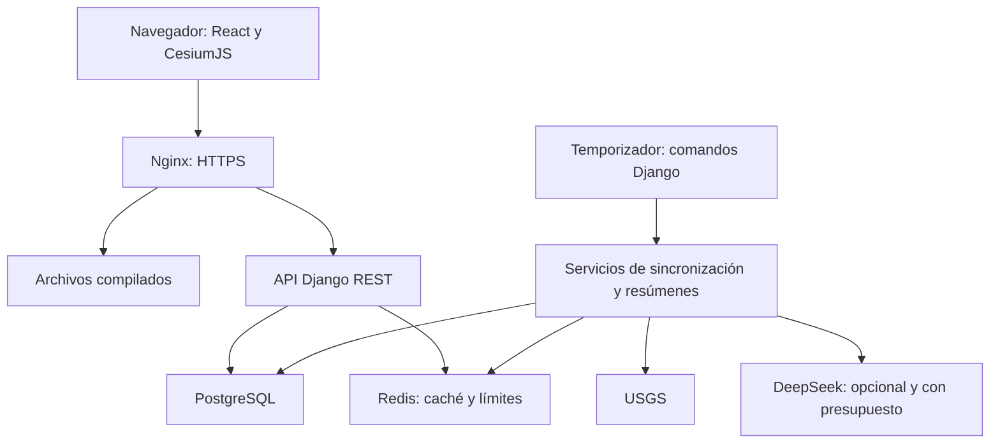

# Arquitectura y decisiones técnicas

## Forma general

Monolito modular Django, frontend React separado y despliegue conjunto en un VPS compartido. La misma procedencia pública (`terramova.andymallcco.dev`) entrega frontend y `/api/v1/` mediante el Nginx del host, que hace `proxy_pass` a `127.0.0.1:8100`; PostgreSQL y Redis solo son alcanzables dentro de la red de Compose. No se necesitan microservicios.



La API pública lee resúmenes guardados. No tiene una ruta de ejecución hacia el proveedor de IA. El proceso programado consulta USGS y solo usa DeepSeek si la configuración lo permite.

## Organización objetivo

```text
frontend/
  src/app/                 # router, providers y composición
  src/features/explore/    # globo, lista, selección, filtros
  src/features/analytics/
  src/features/summaries/
  src/shared/api/          # cliente HTTP y tipos de contrato
  src/shared/ui/           # componentes reutilizables
backend/
  config/                 # settings por entorno, URLs
  core/                   # transversal: errores, paginación, locks, http, logging, health
  apps/earthquakes/        # modelos, selectors, servicios, API y comandos
  apps/analytics/
  apps/summaries/          # resúmenes, presupuesto y registro de uso
  integrations/usgs/      # HTTP, DTOs, normalización
  integrations/llm/       # contrato y adapter DeepSeek
infra/                    # Docker, Nginx y ejemplos de temporizadores
docs/
```

Crear carpetas cuando tengan uso real; no generar archivos vacíos para aparentar arquitectura. El árbol detallado, las reglas de dependencia entre capas y las convenciones están en [STRUCTURE.md](STRUCTURE.md).

## Responsabilidades

| Elemento | Responsabilidad |
| --- | --- |
| Serializer/API view | Validar parámetros, permisos y formato HTTP |
| Selector | Consultas ORM optimizadas y acotadas |
| Servicio | Caso de uso: sincronizar, agregar, generar resumen |
| Adapter | Comunicación externa, timeout, parseo y normalización |
| Modelo | Estado persistido y restricciones de integridad |
| Comando Django | Entrada operativa a un servicio, con códigos de salida útiles |

## SOLID y POO

Responsabilidad única: separar HTTP externo de persistencia y analítica. Abierto a extensión: `EarthquakeSource` y `SummaryProvider` son contratos pequeños para cambiar proveedor. Sustitución: el adapter real y el fake respetan semántica, errores y formatos. Segregación: no crear una interfaz gigantesca de proveedores. Inversión: un servicio recibe el proveedor que necesita por constructor o argumento.

Interfaces propuestas como `typing.Protocol`: `fetch_recent(window)` para datos y `generate_summary(context, max_output_tokens)` para IA. La firma exacta se fija al implementar. No introducir fábricas o Strategy hasta que haya más de una variación real que lo justifique. Usar ORM directamente mediante selectors; repository genérico no requerido.

## Estado frontend

- TanStack Query: datos de API, deduplicación, caché y reintentos acotados.
- URL: filtros, periodo, vista y evento seleccionado cuando sea compartible.
- Estado local: paneles, hover, cámara efímera y reproducción.
- Favoritos locales: IDs y metadatos mínimos, con versión de formato y manejo de almacenamiento no disponible.
- No introducir Redux/Zustand inicialmente; reevaluar solo con evidencia.
- Contrato: tipos generados desde `backend/openapi/schema.yaml` con openapi-typescript y cliente tipado (openapi-fetch). CI falla si el esquema o los tipos están desactualizados.
- Animación: Motion para la interfaz React; la cámara usa las transiciones nativas de Cesium. Ver el sistema de movimiento en UI_UX.md.

El ciclo de React debe crear y destruir correctamente el visor Cesium; limpiar listeners, timers y recursos WebGL. Evitar reconstruir el globo en cada render o disparar una petición por movimiento del puntero. Cargar la librería geográfica por separado (`React.lazy`) y medir tamaño del bundle. Para miles de puntos usar `PointPrimitiveCollection` en lugar de `Entities` y actualizar la colección de forma incremental, sin recrearla. Activar `requestRenderMode` para renderizar solo cuando hay cambios.

## Tareas y operación

Comandos iniciales: `sync_earthquakes`, `generate_activity_summary` y `reconcile_ai_usage` si se necesita reconciliación. Ejecutar desde un contenedor `scheduler` con supercronic que usa la misma imagen del backend (ver STRUCTURE.md); alternativa: temporizador systemd del host. Exclusión mutua con `pg_advisory_lock` y timeout. El scheduler dispara una sola instancia lógica; los bloqueos no dependen de memoria de un worker.

No usar Celery al principio. Si aparecen colas, retrasos, trabajos largos y necesidad de reintentos independientes, documentar el cambio antes de añadirlo.

## Decisión sobre geografía

CesiumJS permite 3D y 2D en un motor. Evaluar integración React directa, recursos estáticos, bundle y rendimiento antes de añadir wrappers. Para primera demo: elipsoide, geometría pública de países e imágenes NASA Blue Marble/Black Marble (dominio público) autoalojadas, con créditos; imágenes detalladas/terreno solo con proveedor y presupuesto verificados. Si Cesium resulta demasiado pesado en el VPS/cliente objetivo, registrar un ADR y evaluar MapLibre antes de cambiar el stack. El renderizado ocurre principalmente en el dispositivo del visitante.

## Escalabilidad de lectura

Casi todo el tráfico es lectura pública de datos que cambian cada pocos minutos, así que la escalabilidad se resuelve sobre todo antes de llegar a Django:

1. **CDN opcional** (por ejemplo, plan gratuito de Cloudflare) delante de Nginx: absorbe tráfico y parte del abuso volumétrico.
2. **Microcaché de Nginx** (`proxy_cache`, 30–60 s) para `GET /api/v1/*`, con `proxy_cache_lock` para que un cache miss no dispare N peticiones a Django.
3. **Cabeceras HTTP**: `Cache-Control: public, max-age` alineado al ciclo de sync, `stale-while-revalidate` y `ETag` derivado de la versión de datos + filtros canónicos; responder 304.
4. **Redis**: caché de aplicación por clave canónica y contadores de throttling compartidos entre workers.
5. **PostgreSQL**: índices medidos. El conjunto de 30 días (~10–15 mil filas) cabe holgadamente en memoria; no optimizar sin medición.

La invalidación se basa en la versión de datos: no se purgan cachés, cambian las claves. Workers Gunicorn dimensionados según CPU/RAM medidos del VPS. Compresión gzip/brotli para JSON y GeoJSON.

## Dependencias

Elegir versiones estables compatibles al inicializar, registrar runtime Python/Node y archivos lock. No asumir que ejemplos antiguos de Cesium, Tailwind o shadcn aplican a las versiones instaladas. Django con soporte de seguridad vigente; imágenes base fijadas y revisión de actualizaciones.
